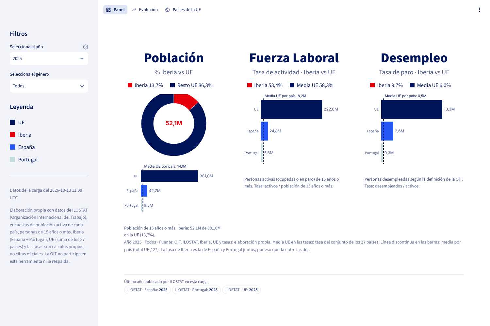
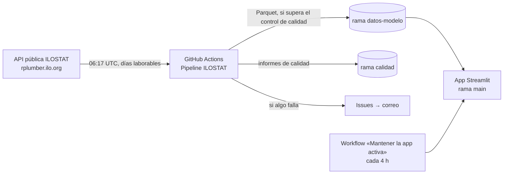

# Mercado laboral · Iberia frente a la UE (ILOSTAT)

App: https://datos-ilostar.streamlit.app/

App web con datos públicos de la **Organización Internacional del Trabajo (ILOSTAT)**: población de 15 años o más,
fuerza laboral y desempleo de **España, Portugal, Iberia y la UE**, actualizada cada día laborable de forma automática.
Misma arquitectura y metodología que `javiermcb/Datos_INE`.

## Arquitectura

| Pieza | Dónde |
|---|---|
| Código del pipeline | `pipeline/` (ingesta, modelo, alertas, publicación) · configuración en `pipeline/config/` |
| App | `streamlit_app/`: Panel (Población, Fuerza laboral, Desempleo), Evolución, Países de la UE; pruebas en `tests/` |
| Datos publicados para la app | rama `datos-modelo` (se reescribe en cada carga) |
| Informes de calidad de cada carga | rama `calidad` |
| Exploración de la API | `exploracion/explorar_ilostat.py` |

## Datos

| Indicador ILOSTAT | Qué es |
|---|---|
| `POP_XWAP_SEX_AGE_NB_A` | Población en edad de trabajar (15 años o más) |
| `EAP_TEAP_SEX_AGE_NB_A` | Fuerza laboral (ocupados + desempleados, 15 años o más) |
| `UNE_TUNE_SEX_AGE_NB_A` | Desempleados (15 años o más, definición de la OIT) |

Encuestas de población activa de cada país, en miles de personas, por sexo y año. ILOSTAT no publica un total de la UE
para estos indicadores, así que se calcula:

- **Iberia** = España + Portugal.
- **UE** = suma de los 27 países, solo en los años en que están los 27 (si falta uno, ese año no hay dato de la UE).
- **Tasa de actividad** = fuerza laboral / población 15+. **Tasa de paro** = desempleados / fuerza laboral.

Son cálculos propios, no cifras oficiales de la OIT. Si ILOSTAT da varias encuestas para un país, se usa una sola
(la que cubre más indicadores y llega a un año más reciente); la elegida queda en `fuentes_elegidas.csv`.

## Workflows (`.github/workflows/`)

| Workflow | Cuándo | Qué hace |
|---|---|---|
| `pipeline_ilostat.yml` | días laborables 06:17 UTC, cambios en `pipeline/` | descarga, modelo, control de calidad y publicación (solo desde `main`); avisa por issue si falla |
| `app_pruebas.yml` | cambios en `streamlit_app/` | abre todas las páginas con la muestra |
| `pipeline_pruebas.yml` | cambios en `pipeline/` y PRs | pruebas sin red: lectura de ILOSTAT, modelo, control antes de publicar, avisos |
| `mantener_app_activa.yml` | cada 4 horas | abre la app (https://datos-ilostar.streamlit.app/) para que Streamlit no la duerma |
| `explorar_ilostat.yml` | manual / `exploracion/` | comprueba formato y cobertura de la API |

## Documentación

- `docs/operacion.md` — qué hacer cuando algo falla.
- `docs/puesta_en_marcha.md` — pasos para publicar los datos y desplegar la app.
- `streamlit_app/README.md` — la app, cómo ejecutarla en local y desplegarla.
